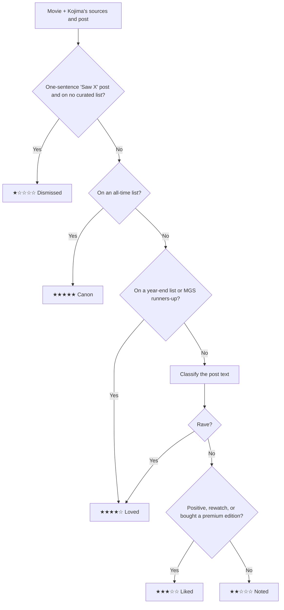

# 🎬 Kojima Movie Tracker (`$:/plugins/mblackman/kojima-media`)

TiddlyWiki 5 plugin for [`tiddlywiki-media-importer`](https://github.com/mblackman/tiddlywiki-media-importer) that imports, ranks, and tracks movies recommended or reviewed by **Hideo Kojima**.

- **Live Demo Wiki**: [https://mblackman.github.io/tiddlywiki-kojima-media/](https://mblackman.github.io/tiddlywiki-kojima-media/)
- **Hosted Recommendations JSON Feed (CORS-enabled)**: [`https://mblackman.github.io/tiddlywiki-kojima-media/api/kojima-recommendations.json`](https://mblackman.github.io/tiddlywiki-kojima-media/api/kojima-recommendations.json)
- **Optional Self-Hosted Docker Image (GHCR)**: `ghcr.io/mblackman/tiddlywiki-kojima-media:latest` (`linux/amd64`, `linux/arm64`)

---

## Features

- **Zero-Server Setup via GitHub Pages**:
  - A scheduled GitHub Actions workflow (`.github/workflows/ci.yml`) runs daily to score Kojima's movie recommendations and publish both the **interactive demo TiddlyWiki** (`https://mblackman.github.io/tiddlywiki-kojima-media/`) and the **public JSON feed** (`https://mblackman.github.io/tiddlywiki-kojima-media/api/kojima-recommendations.json`).
  - Installed copies of the plugin default to that GitHub Pages feed URL — clicking **🔄 Sync Kojima Feed** downloads the latest recommendations directly into your wiki with **no Docker container required**.
  - You can also point the feed URL in `$:/plugins/mblackman/kojima-media/configs/kojima-sync-url` to your own fork's GitHub Pages URL or a local server.
- **5-Level Kojima Enthusiasm Rating**: every movie is rated ★★★★★ Canon, ★★★★☆ Loved, ★★★☆☆ Liked, ★★☆☆☆ Noted, or ★☆☆☆☆ Dismissed based on where Kojima recommended it and what he said. See [How Enthusiasm Ratings Are Determined](#how-enthusiasm-ratings-are-determined).
- **Standalone & `media-importer` Compatible**:
  - Syncs directly from the configured JSON feed (`tm-sync-kojima`) and delegates canonical `Movie` tiddler creation to `media-importer` when a TMDB API key is configured.
  - Preserves your existing watch status (`Completed`, `Active`, `Dropped`, `Backlog`), `favorite`, and `rating` across re-syncs.
- **11 Dashboard Sort Modes**:
  - Sort by **Enthusiasm Level**, **Date Recommended (`kojima-recommended-at`)**, **Release Year**, **Review Depth (Word Count)**, **Runtime**, **Title**, or **Director**.

---

## How Enthusiasm Ratings Are Determined

Every movie gets one of five levels. The rating answers one question: **how strongly has Kojima shown that he values this film?** Two kinds of evidence count:

1. **Where he recommended it.** Picking a film for an all-time or year-end list is a deliberate choice. He watches 250+ films a year, so making one of these lists is a strong signal on its own.
2. **What he said about it.** For one-off posts on X (@HIDEO_KOJIMA_EN), the wording of the post decides the level.

### The five levels

| Level | Label | What it means | How a movie gets here |
|---|---|---|---|
| ★★★★★ 5 | **Canon** | A lifelong, all-time favorite | Appears on an all-time list: **GQ All-Time Top 4**, **Rotten Tomatoes Five Favorite Films**, the **core films that shaped Metal Gear Solid**, the **Junker HQ "My Favorite Films" Top 30**, or his **Criterion Closet** picks |
| ★★★★☆ 4 | **Loved** | A standout he championed | Appears on a **year-end (or mid-year) top movies list** or the **Junker HQ runners-up / MGS influences**, **or** his post is a rave |
| ★★★☆☆ 3 | **Liked** | A clear thumbs-up | His post is positive, **or** he chose to rewatch it or bought a premium edition (4K, Blu-ray, box set) |
| ★★☆☆☆ 2 | **Noted** | Watched and discussed, no clear verdict | His post is descriptive, analytical, mixed, or just says he is watching it tonight |
| ★☆☆☆☆ 1 | **Dismissed** | His famous non-review | A single short sentence that only says he saw it, e.g. *"Saw Madame Web at the theater."* |

### Why each level sits where it does

**★★★★★ Canon: lifelong favorites he has chosen to name publicly.**
These lists are small and permanent: a Top 4, a Top 5, the handful of films that shaped Metal Gear Solid, a Top 30 of all time, and the films he took from the Criterion Closet. Each one asks him to choose a few films from a lifetime of watching, and several are films he names as direct influences on his games. Nothing else in the data is that strong, so these films sit alone at the top.

**★★★★☆ Loved: films he went out of his way to champion.**
Two kinds of evidence earn this level, and we treat them as equal:
- **A year-end (or mid-year) top list.** He watches 250+ films a year, so making that list means beating most of a year's viewing. It ranks below Canon because it compares the film only against that year's releases, not against his whole life.
- **A rave on X.** Calling a film a *masterpiece*, saying it *rewrote the history of cinema*, or admitting it made him *cry* is a public, unprompted recommendation just as strong as a list pick. It's still one reaction at one moment, so it can't reach Canon.

The **Junker HQ runners-up** are here too. These films just missed his all-time Top 30 and are the ones he credits as influences on Metal Gear Solid. That's more than a passing liking, but by his own ranking it's a step below the Top 30.

**★★★☆☆ Liked: clearly positive, without the superlatives.**
He enjoyed it and said so (*great*, *enjoyed*, *wonderful*), but didn't call it among the best. This level also covers actions that show attachment without words: **rewatching** a film or **buying a premium edition** (4K, Blu-ray, box set). Choosing to spend time or money on a film again is a real endorsement, even in a post that only says *"Tonight, I'm rewatching 'INTERSTELLAR'…"*

**★★☆☆☆ Noted: he engaged with it but gave no verdict.**
He watched it and wrote about it, but only described the story, analyzed how it was made, compared it to other films, or announced he was watching it. That shows interest, not enthusiasm, so it sits in the middle: above a dismissal, below any clear praise.

**★☆☆☆☆ Dismissed: the pointed non-review.**
Most of Kojima's film posts run several sentences. When the whole post is *"Saw Madame Web at the theater."*, the missing commentary is itself the signal. A film he chose to say nothing about is a weaker recommendation than one he discussed, so this ranks below Noted.

### Principles behind the rules

1. **Choices count more than adjectives.** What he *did* (put a film on a list, rewatched it, bought it) is checked before what he *wrote*. Choices are deliberate and comparable from film to film; adjectives depend on mood and translation.
2. **The strongest evidence wins, and evidence only adds.** A film's level is the highest one any of its sources supports. A short or third-person blurb never pulls a list pick down, and a lukewarm post can't undo a Top 30 pick. A Noted film moves up automatically if it later appears on a year-end list.
3. **Length is not enthusiasm.** A long post can be purely analytical (*Supergirl*), and a short one can be a rave. Word count is shown on each card for interest but plays no part in the rating.
4. **Short isn't automatically a dismissal.** A one-liner only counts as Dismissed when the film appears on none of his curated lists. *"Saw 2001: A Space Odyssey."* from a Top 4 film is still Canon.
5. **Five levels, not a 0–100 score.** The evidence comes in kinds (an all-time list, a year-end list, a rave, a thumbs-up, silence), not in measurable amounts. A score like 77 vs 74 would suggest a precision the data doesn't have, so each level is defined by a rule anyone can check against the source.

### Step by step



1. **Dismissal check.** A post of 15 words or fewer that is one sentence starting with *"Saw…"*, *"Watched…"*, *"Went to see…"* or *"Finally got to see…"* is **Dismissed**. A film that appears on any curated list is never treated as a dismissal, however short the text.
2. **Curated lists decide Canon and Loved.** If the film appears on any of the lists above, it gets that list's level. When it appears on several, the highest one wins. The post text is not analyzed, because it can't raise the level and shouldn't lower it.
3. **Otherwise, the post text decides.** Standalone X posts are classified as **Loved**, **Liked** or **Noted** using the criteria below.

### How post text is classified

The service supports two classifiers. Both use the same criteria.

**AI classifier (optional).** When `LLM_PROVIDER` is set to `gemini`, `openai`, or `ollama`, the post is sent to the model with this rubric:

- **loved**: a rave. Superlatives, strong emotion, calls it among the best, or says it moved him deeply.
- **liked**: clearly positive or recommends it, or he chose to rewatch it or owns a premium edition.
- **noted**: neutral, purely descriptive or analytical, mixed, or only announces that he is watching it.

If the model call fails or returns anything other than these three labels, the keyword classifier is used instead.

**Keyword classifier (default, no setup).** This is what the public GitHub Pages feed uses. It looks for whole words and phrases (so *"crystal"* never counts as *"cry"*):

| Signal | Examples | Result |
|---|---|---|
| Rave phrase or superlative | *masterpiece*, *history of cinema*, *miracle*, *god of cinema*, *speechless*, *must-see*, *best film*, *of the year*, *blown away*, *magnificent*, *incredible*, *brilliant*, *favorite*, *cried* | **Loved** |
| Three or more positive words | *excellent*, *great*, *loved*, *enjoyed*, *beautiful*, *satisfying*, *spot-on*, *gripping*, *wonderful*, *recommend*, *entertaining* | **Loved** |
| One or two positive words | (same list) | **Liked** |
| Rewatch or ownership | *rewatching*, *saw it again*, *second time*, *bought the Blu-ray*, *4K UHD*, *box set* | **Liked** |
| None of the above | | **Noted** |

Praise preceded by a negation such as *not*, *never* or *wasn't* within a few words (*"not a masterpiece"*) is ignored.

### Real examples from the feed

| Movie | Evidence | Rating |
|---|---|---|
| *Taxi Driver* | GQ All-Time Top 4 | ★★★★★ Canon |
| *Deadpool* | Named to his Favorite Films of 2016 list | ★★★★☆ Loved |
| *Hamnet* | *"…has the power to rewrite the history of cinema. It lays bare the miracle of movies."* | ★★★★☆ Loved |
| *Crime 101* | *"It was excellent! Completely satisfying! … spot-on … films I loved as a kid."* | ★★★★☆ Loved |
| *Interstellar* | *"Tonight, I'm rewatching 'INTERSTELLAR' (2014) for the first time in 12 years…"* | ★★★☆☆ Liked |
| *Split Second* | *"Bought the Blu-ray of 'Split Second.'…"* | ★★★☆☆ Liked |
| *Supergirl* | An analytical comparison to other films, with no verdict | ★★☆☆☆ Noted |
| *Madame Web* | *"Saw Madame Web at the theater."* | ★☆☆☆☆ Dismissed |

### Where to see why a movie got its rating

Hover over the star badge in the dashboard or on a movie's page to see the reason, e.g. `Loved (4/5) - Rave language: history of cinema, miracle, beautiful.` The same text is stored in the `kojima-score-breakdown` and `kojima-sentiment-summary` fields. The level itself is in `kojima-score` (`1`–`5`) and the label in `kojima-tier`.

### Ordering within a level

Many movies share a level. The default **★ Enthusiasm** sort orders them by level first, then by **most recently recommended**, then by title. The other sort modes order by their own field (date recommended, release year, runtime, director) and use the level only to break ties. **Title** sort ignores the level.

### Limitations

- The keyword classifier only reads English text and can miss praise phrased in unusual ways. The AI classifier handles nuance better.
- A level reflects the strongest evidence collected so far. A film rated Noted from one X post moves up automatically if it later appears on a year-end list.
- Ratings are fixed rules, not personal scores. Two Loved films are not ranked against each other.

---

## Recommendations Catalog & Persistent Ledger

| File | Purpose | Shipped in plugin? |
| :--- | :--- | :---: |
| [`catalog/kojima-canon.jsonl`](./catalog/kojima-canon.jsonl) | Hand-curated source list (one JSON object per line): Junker HQ Top 30 + runners-up, 15 films that inspired Metal Gear, Criterion Closet picks, year-end lists (2015–2024), and one-sentence reviews. Add a line to add a movie. | No |
| [`demo/seed-recommendations.json`](./demo/seed-recommendations.json) | Git-persisted ledger of every scored movie (score, poster, metadata, `content_hash`) plus `last_updated`. Committed by the scheduled workflow only when something changes. | No |

`npm run generate-feed` (`python3 kojima_sync_service.py --sync-static`) is incremental:

- Movies already in the ledger are restored as-is, with no re-scoring and no network calls. Only new or edited catalog entries get scored (a `content_hash` mismatch triggers it; bumping `SCORING_ENGINE_VERSION` re-scores everything).
- Missing posters and plots come from Wikipedia (no API key needed), or from TMDB when `TMDB_API_KEY` is set.
- RSS posts dated before the ledger's `last_updated` are skipped.
- `last_updated` only changes when the item list changes, so unchanged runs produce no commits.
- Flags: `--force-rescore` (re-score every movie), `--no-enrich` (skip poster lookups).

---

## Local Demo & Plugin Development

You can generate the recommendations feed, populate the demo site (`demo/tiddlers/KojimaMovies.json` + `build/api/kojima-recommendations.json`), and test everything locally without Docker:

```bash
npm install

# 1. Run Python scoring engine & populate demo/tiddlers/KojimaMovies.json + build/api/kojima-recommendations.json
npm run seed-demo

# 2. Start the live local TiddlyWiki demo server on http://localhost:8080 (auto-seeds on startup)
npm run dev

# 3. Run Python + TiddlyWiki test suites
npm test

# 4. Build plugin bundle (dist/kojima-media-plugin.json), demo HTML (build/index.html), and static feed
npm run build-all
```

---

## Optional Self-Hosted Docker Setup (GitHub Container Registry)

If you prefer to run your own local sync service (for example, with custom RSS feeds or local Ollama/OpenAI/Gemini LLM scoring), a multi-arch (`linux/amd64` and `linux/arm64`) image is published to **`ghcr.io/mblackman/tiddlywiki-kojima-media:latest`**. In TiddlyWiki's **Control Panel → Settings → Kojima Movie Tracker**, click **🐳 Use Local Server (`localhost:8765`)** to point the plugin to your container.

### Option 1: Docker Compose (Recommended)

Create a `docker-compose.yml` file (or use the included [`docker-compose.example.yml`](./docker-compose.example.yml)):

```yaml
services:
  kojima-movie-sync:
    image: ghcr.io/mblackman/tiddlywiki-kojima-media:latest
    container_name: kojima-movie-sync
    ports:
      - "8765:8765"
    volumes:
      - kojima_data:/data
    environment:
      - PORT=8765
      - KOJIMA_DB_PATH=/data/kojima_reviews.db
      # Optional: TMDB API Key to auto-resolve TMDB IDs for newly scraped X posts
      - TMDB_API_KEY=${TMDB_API_KEY:-}
      # Optional: Comma-separated RSS/Atom feed URLs (e.g. Nitter / RSSHub / Letterboxd)
      - KOJIMA_RSS_URLS=${KOJIMA_RSS_URLS:-}
      - SCRAPE_INTERVAL_SECONDS=${SCRAPE_INTERVAL_SECONDS:-3600}
    restart: unless-stopped

volumes:
  kojima_data:
```

Start the container and verify health:

```bash
docker compose up -d
curl http://localhost:8765/health
```

### Option 2: `docker run` One-Liner

```bash
docker run -d \
  --name kojima-movie-sync \
  -p 8765:8765 \
  -v kojima_data:/data \
  --restart unless-stopped \
  ghcr.io/mblackman/tiddlywiki-kojima-media:latest
```

### HTTP Endpoints

| Endpoint | Method | Description |
| :--- | :---: | :--- |
| `/health` | `GET` | Health status, SQLite item count, and last RSS scrape timestamp |
| `/api/kojima-recommendations` | `GET` | Ranked JSON feed consumed by TiddlyWiki's **Sync Kojima Reviews** button (`?rescore=1` forces re-scoring) |
| `/api/scrape` | `POST` | Triggers an immediate RSS/Atom feed poll across `KOJIMA_RSS_URLS` |
| `/api/ingest-post` | `POST` | Manually ingests a raw X post JSON (`{"text": "...", "url": "...", "tmdb_id": "..."}`) |
